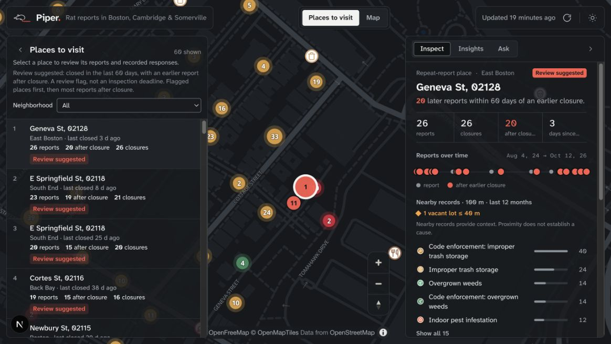
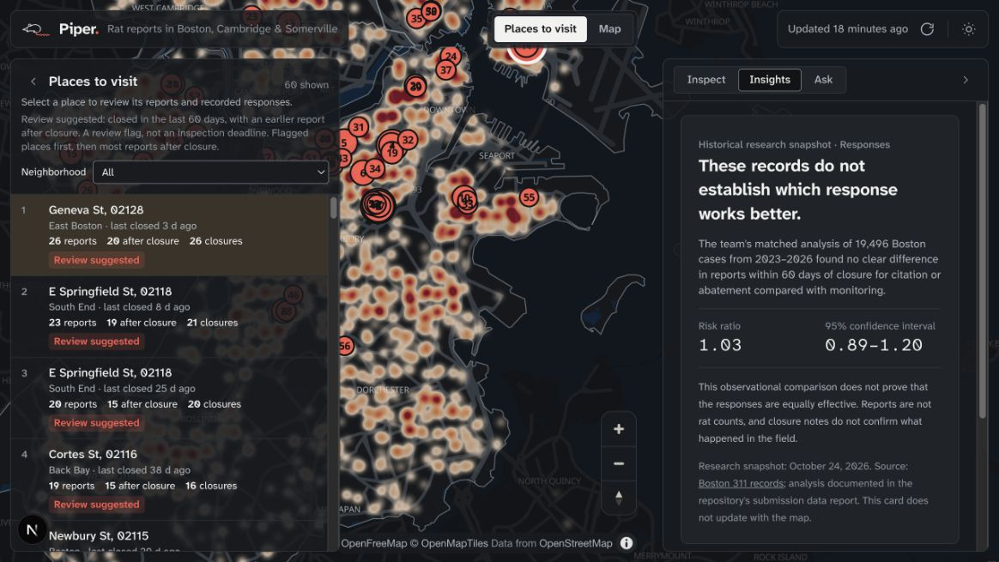

# Piper — review the places behind repeated rodent reports

Piper helps Boston rodent inspectors and the Boston Rodent Action Plan coordinator review repeated 311 reports at one place, examine recorded responses, and identify nearby records worth investigating.

## The problem

A closed service request does not tell an inspector whether the reported condition was resolved. Related reports and responses can be scattered across dates and datasets. Piper gathers that evidence into a place-level review, so an inspector can investigate with context. Residents and councillors can also explore the public records, but the current prototype's primary user is an inspector.

## What works now

1. Open **Places to visit**, the default view, and optionally filter by neighborhood.
2. Select an address to see report counts, a timeline, closure notes, and reports recorded within 60 days after an earlier closure.
3. Review nearby records within 100 meters and adjacent vacant-parcel context. These records suggest questions for inspection; proximity does not establish a cause.
4. Switch to **Map** to inspect individual records and their source links, explore the available municipal layers, or examine the four-week Boston report forecast.
5. Open **Insights** for a dated research snapshot. The matched comparison found no clear difference between citation/abatement and monitoring; it does not establish equal effectiveness.

The completed output is a reviewed place and its supporting records. “Review suggested” is a heuristic, not an official deadline. The inspector retains the decision about further investigation.

## Data and trust

The web app reads the populated Supabase database. The Python pipeline ingests public records, including [Boston 311](https://data.boston.gov/dataset/311-service-requests), code enforcement, property/parcel context, permits, and NOAA weather. Cambridge and Somerville layers add context but use different reporting systems. Historical research figures have an October 24, 2026 cutoff; operational source freshness depends on the last successful ingestion. See the [data report](data-report.md) for methods and limits.

Piper counts reports, not rats. It does not infer treatment effectiveness from closure codes, identify a vacant lot as a proven cause, or claim that Boston has never measured outcomes. It supports the city's existing [Boston Rodent Action Plan](https://www.boston.gov/departments/inspectional-services/boston-rodent-action-plan-brap).

## Accessibility

A selectable list provides an alternative to finding map points. Controls have text or accessible labels, and the interface includes focus styles and reduced-motion support. These are implemented affordances, not a claim of WCAG certification. Full screen-reader, keyboard, contrast, and responsive audits remain outstanding.

## Current limits

The Ask assistant, next-action recommendation, approval/work-order flow, and trial designer are not connected end to end. There is no completed resident service submission or government integration. Live data access requires the configured database; local snapshots are not an automatic fallback. Forecasts estimate reports and may reflect unequal reporting. The Insights cards are historical research, not live calculations.

## Kiro evidence and demonstration

See [How we used Kiro](kiro-usage.md) for the concrete research/specification trail and [the current-build demo script](demo-script.md) for a recording path that uses implemented features. The public demo video has not yet been published. The screenshots below were captured from the local build on October 24, 2026. Earlier concept mockups should not be presented as shipped functionality.

